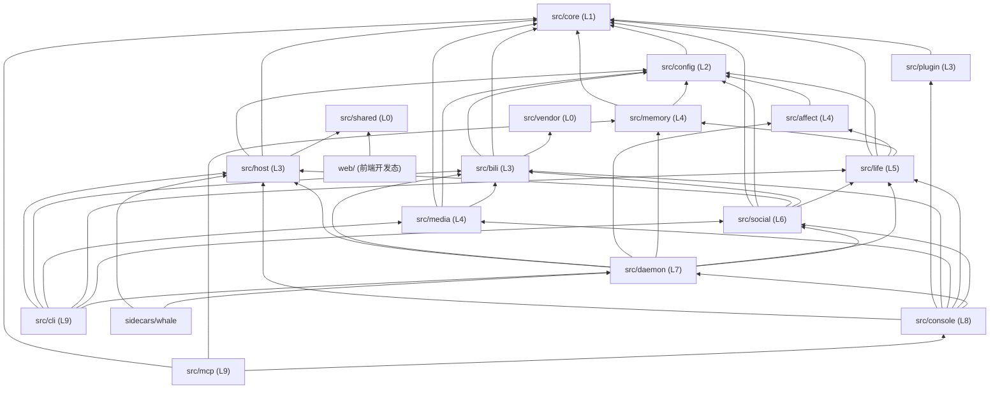

# 项目架构与目录规范（Architecture）

本文档是 `antigravity-bili-whale` 目录布局、分层职责、命名约定、ES2026 语法基线、Markdown 规范与自动化校验规则的唯一权威地图。所有规则均由 [`scripts/check-structure.mjs`](../scripts/check-structure.mjs) 在 `npm run check:structure`、`npm test` 和 CI 中自动强制执行。

---

## 1. 顶层目录与职责划分

| 路径 | 阶段 / 分类 | 职责说明 | 是否随发布包下发 |
| --- | --- | --- | --- |
| `plugin.json` | 平台契约 | Antigravity 插件元数据、名称、版本、Logo 与推荐提示词 | 是 |
| `mcp_config.json` | 平台契约 | MCP Server 启动配置（指向 `${PLUGIN_ROOT}/src/mcp/server.mjs`） | 是 |
| `assets/` | 平台契约 | 插件图标等静态资源（`assets/logo.png`） | 是 |
| `skills/` | 平台契约 | Antigravity Skill 定义（`skills/antigravity-bili-whale/SKILL.md`） | 是 |
| `sidecars/` | 平台契约 | Antigravity 原生托管的无头后台守护入口（`sidecars/whale/sidecar.json` + `main.mjs`） | 是 |
| `behavior/` | 运行态业务资产 | 各场景行为规范章节（`index.md` + 10 个小写 `kebab-case` 章节，控制台可直达） | 是 |
| `stickers/` | 运行态业务资产 | 内置 42 张表情包纯静态资产（`index.json` + `small/`） | 是 |
| `dist/` | 运行态构建产物 | 预打包单文件控制台前端产物（`dist/app.html`，零运行时依赖） | 是 |
| `docs/` | 运行态文档 | 架构规范（`architecture.md`）、用户数据目录规范（`user-data.md`）、状态契约（`life-state-contract.md`）、流水线说明（`pipeline.md`）与配置样例 | 是 |
| `src/` | 运行态核心源码 | 16 个单向无环领域子目录，全部统一 `.mjs`，零外部 npm 运行依赖 | 是 |
| `web/` | 开发态前端源码 | 左侧栏全页控制台源码（入口 `main.mjs`/`bridge.mjs` + `views/` 视图模块，打包输出至 `dist/app.html`） | 否 |
| `scripts/` | 开发态工具脚本 | 前端构建、结构与语法/Markdown 守卫、运行清单同步、本地部署与发布打包脚本 | 否 |
| `test/` | 开发态测试套件 | 按 `host/`、`plugin/`、`runtime/`、`structure/`、`fixtures/` 语义分层的自动化测试 | 否 |
| `.github/` | 开发态 CI | GitHub Actions 自动测试（Node 24）与 Release 打包发布流程 | 否 |
| `AGENTS.md` | 开发态协作规则 | 面向 AI 编程助手的仓库目录规范与必跑校验指令 | 否 |

---

## 2. `src/` 领域分层与依赖边界

`src/` 内部划分为 **16 个职责单一、严格单向、零循环** 的领域子目录：

| 层级 | 目录 | 负责 | 不负责 | 允许依赖的 `src/` 层 |
| --- | --- | --- | --- | --- |
| L0 | `src/shared` | 浏览器前端与 Node 后端共享的纯计算工具（如 `quota-percentage.mjs`） | 任何 `node:*` API 或 IO | 无（且禁 `node:*`） |
| L0 | `src/vendor` | 零依赖内嵌第三方代码（如 MIT 许可的 `qrcode`） | 项目自身业务逻辑 | 无（且禁 `node:*`） |
| L1 | `src/core` | 底层基础设施：路径与用户数据目录真理源（`paths.mjs`/`data-paths.mjs`）、原子 JSON 写入、Windows ACL、进程锁、子进程采集、Node 运行时探测（`node-binary.mjs`/`node-runtime.mjs`/`runtime-probe.mjs`）、日志诊断、规范与表情加载 | 业务配置 schema、网络请求或平台协议 | 无 |
| L2 | `src/config` | 纯配置默认值、归一化校验、作息计划推演、口味偏好匹配、会话边界指纹 | 执行网络请求或直接修改运行状态 | `core` |
| L3 | `src/host` | Antigravity 宿主通信：`rpc.mjs`、`session.mjs`、`text-complete.mjs`、`model-quota-guard.mjs`、`sidecar-ipc.mjs` | B 站平台协议或业务调度 | `shared`, `core`, `config` |
| L3 | `src/plugin` | 插件运行包校验、零依赖入口依赖图静态分析、原子安装/原地回滚切换、GitHub 检查与更新 | 控制台 UI 渲染或后台调度 | `core` |
| L3 | `src/bili` | B 站平台协议：`api.mjs`、`cookie.mjs`、`credential-store.mjs`、`auth.mjs`、`qr.mjs`、`traffic.mjs`、`message-feed.mjs`、`relation.mjs`、`favorites.mjs`、`upload-pic.mjs` | 长期记忆存储或 AI 调度 | `vendor`, `core`, `config` |
| L4 | `src/media` | 音视频与画面处理：ffmpeg 探测、视频下载、分段抽帧、封面保存、字幕筛选、观看时长/拼图策略 | 评论/私信发送或记忆存储 | `core`, `config`, `bili` |
| L4 | `src/memory` | 记忆建模与检索：可见范围、倒排索引、相关性评分、记忆关联、生命周期、上下文编译、认知归纳规则、动态记忆与冷归档只读校验 | 检查点事务提交或网络请求 | `core`, `config` |
| L4 | `src/affect` | 心情与主动表达状态机引擎、互动时机判断 | 模型推理与实际发消息 | `core`, `config` |
| L5 | `src/life` | 长期状态权威引擎：检查点持久化、热事件冷归档、跨进程事务存储（`store.mjs`）、运行时工厂（`runtime.mjs`） | 社交发信限额记账或平台网络调用 | `core`, `config`, `memory`, `affect` |
| L6 | `src/social` | 外发安全与社交闸门：双层内容安全审核、写前预览令牌、每日/粉丝额度账本与限额闸、发送守卫（`send-guard.mjs`）、评论/私信上下文工具 | 控制台 HTTP/MCP 协议或调度器循环 | `core`, `config`, `host`, `bili`, `life` |
| L7 | `src/daemon` | 后台守护核心：生物钟调度器、投递状态账本、隔离投递、唤醒运行器、三大 Worker（`affect`/`formation`/`safety`）、健康快照 | MCP 工具协议或前端面板 API | `core`, `config`, `host`, `bili`, `memory`, `affect`, `life`, `social` |
| L8 | `src/console` | 控制台后端业务：面板 API 处理器（`api-handlers.mjs`）与活动日历统计（`activity-stats.mjs`） | stdio JSON-RPC 传输细节 | `core`, `config`, `host`, `plugin`, `bili`, `media`, `life`, `social`, `daemon` |
| L9 | `src/mcp` | stdio JSON-RPC 2.0 MCP Server、全页控制台 app-only 工具、面向模型的读写分离工具（`bili_read`/`bili_write`） | 直接操作 B 站底层协议 | `core`, `memory`, `console` |
| L9 | `src/cli` | B 站统一 CLI 入口（`bili.mjs`）及与命令名 1:1 对应的 `commands/`、`pipeline/`、`verify/`、`diagnostics/` | 被底层库反向引用 | `core`, `config`, `host`, `bili`, `media`, `affect`, `life`, `social`, `daemon` |

### 分层依赖视图



---

## 3. 命名、ES2026、Markdown 与用户数据目录规范

### 3.1 文件与内部命名
1. **统一扩展名与大小写**：`src/`、`web/`、`scripts/`、`sidecars/`、`test/` 下全部模块统一使用 **`.mjs`** 与小写 **`kebab-case`**，禁止 `.js` / `.cjs`。
2. **禁止目录内冗余前缀与遗留缩写**：目录名本身已表达域归属（如 `src/host/rpc.mjs` 不再叫 `antigravity-rpc.mjs`，`web/views/about.mjs` 不再叫 `render-about.mjs`，`src/cli/commands/night.mjs` 不再叫 `whale-night.mjs`）；全仓禁用遗留的 `DSH_HOME`、`dshPath`、`dshHome` 命名。
3. **测试语义分组**：测试放在 `test/{host,plugin,runtime,structure}/*.test.mjs`，夹具放在 `test/fixtures/*.mjs`。

### 3.2 ES2026 / Node 24+ 语法基线
- **运行与打包基线**：`engines.node >= 24.0.0`，CI 使用 Node 24，前端打包（`scripts/build-ui.mjs`）使用 `esbuild` `target: ['esnext']`。
- **严格纯 ESM**：禁止 `var`、禁止 CommonJS（`module.exports`/`exports.`/`__dirname`/`__filename`/顶层 `require`）、所有 Node 内置模块必须使用 `node:` 协议前缀。
- **V8 13.6 安全边界**：鼓励使用 Node 24（V8 13.6）已实装的 ES2024–ES2026 特性（`Error.isError`、`RegExp.escape`、`Array.fromAsync`、`Promise.withResolvers`、`Object.groupBy`、`Iterator` 辅助、`Set` 集合运算、`using`/`await using`）；`check-structure.mjs` 会静态拦截当前 V8 13.6 尚未实现的 4 组 API（`Math.sumPrecise`、`Uint8Array.fromBase64`/`.toBase64`/`fromHex`/`.toHex`、`Map.prototype.getOrInsert`/`getOrInsertComputed`、`Iterator.concat`），避免运行时报错。

### 3.3 Markdown 文档规范
- 除根目录惯例文件（`README.md`、`NOTICE.md`、`AGENTS.md`）与平台契约（`skills/*/SKILL.md`）外，全部 `.md` 文件使用小写 `kebab-case`（含 `behavior/index.md`）。
- 全部 `.md` 文件必须满足：LF 换行、文件尾换行、跳过可选 YAML frontmatter 后恰有 1 个 `# ` 一级标题、标题层级连续不跳级、所有本地相对链接真实有效（由 `check-structure.mjs` 自动校验）。

### 3.4 用户数据目录单一真理源
- 用户独立数据目录 `%USERPROFILE%\.antigravity-bili-whale\` 采用六类规范分层，详见 [`docs/user-data.md`](user-data.md)。
- 代码中必须通过 [`src/core/data-paths.mjs`](../src/core/data-paths.mjs)（`dataPathsFor(whaleHome)` / `DATA_PATHS`）获取路径，`check-structure.mjs` 禁止在 `src/` 中回归硬编码旧版散落文件名（如 `whale-night.json`、`whale-life`、`whale-work`、`dev_id` 等）。

### 3.5 代码注释规范
- 除 `src/vendor/` 外，全部 `.mjs` 文件顶部（shebang 之后）统一以中文 `/** ... */` 简明说明**本文件的具体职责**，禁止机械套用目录名 + 文件名占位模板（如 `（xxx.mjs）。`）。
- 行内与分段注释统一使用简洁简体中文，中英文与数字间保留 1 个半角空格，禁止残留废弃旧路径/旧文件名（`lib/msgfeed.mjs`、`lib/qr.js`、`ui-src/`、`tools/lib/`）及 ASCII 装饰分隔线。

### 3.6 控制台 UI 与文案规范
- **样式与组件收口**：`web/` 的静态布局、边距与横幅风格统一收口至 [`web/styles.css`](../web/styles.css) 语义类，并通过 [`web/views/sections.mjs`](../web/views/sections.mjs) 导出的 `statusPill`、`metaPill`、`banner` 构造复用；视图中仅允许运行时动态数值（如进度条宽度）使用内联 `style`。
- **徽章与标点口径**：状态徽章统一带 `.dot` 圆点、计数/元信息徽章统一无 `.dot`；文案统一盘古空格（如 `B 站`、`Windows 用户`）、全角标点、Unicode 箭头 `→`、直角引号 `「」`、短破折号 `–` 与中文省略号 `…`；产品称谓统一使用 `哔哩哔哩大鲸鱼` / `大鲸鱼` / `UID` / `后台守护（Sidecar）` / `配额`；全站严禁 `✓` 与原生 `title:` 属性。

---

## 4. 改动后的标准校验流程

```powershell
npm run build:ui         # 若修改了 web/，重新打包 dist/app.html（esnext）
npm run sync:manifest    # 若增删改了运行态文件，自动同步 package.json 的 whaleRuntimeFiles
npm run check:structure  # 全量校验目录、命名、分层依赖、无环、ES2026、Markdown、注释、UI 文案与版本一致性
npm test                 # 运行完整自动化测试套件
```

也可直接运行组合命令 `npm run verify` 一次性完成前端构建、全量守卫与自动化测试。
