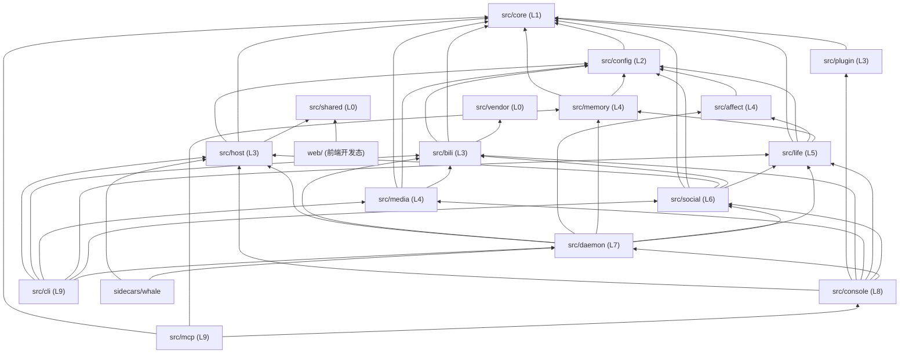

# 项目架构与目录规范（Architecture）

本文档是 `antigravity-bili-whale` 目录布局、分层职责、命名约定与自动化校验规则的唯一权威地图。所有目录与依赖规则均由 [`scripts/check-structure.mjs`](../scripts/check-structure.mjs) 在 `npm run check:structure`、`npm test` 和 CI 中自动强制执行。

---

## 1. 顶层目录与职责划分

| 路径 | 阶段 / 分类 | 职责说明 | 是否随发布包下发 |
| --- | --- | --- | --- |
| `plugin.json` | 平台契约 | Antigravity 插件元数据、名称、版本、Logo 与推荐提示词 | 是 |
| `mcp_config.json` | 平台契约 | MCP Server 启动配置（指向 `${PLUGIN_ROOT}/src/mcp/server.mjs`） | 是 |
| `assets/` | 平台契约 | 插件图标等静态资源（`assets/logo.png`） | 是 |
| `skills/` | 平台契约 | Antigravity Skill 定义（`skills/antigravity-bili-whale/SKILL.md`） | 是 |
| `sidecars/` | 平台契约 | Antigravity 原生托管的无头后台守护入口（`sidecars/whale/sidecar.json` + `main.mjs`） | 是 |
| `behavior/` | 运行态业务资产 | 各场景行为规范 `.md`（控制台「关于与更新」可直接打开） | 是 |
| `stickers/` | 运行态业务资产 | 内置 42 张表情包及目录索引（与用户数据目录 `stickers/` 对称） | 是 |
| `dist/` | 运行态构建产物 | 预打包单文件控制台前端产物（`dist/app.html`，零运行时依赖） | 是 |
| `docs/` | 运行态文档 | 架构地图、产品定位、长期状态契约、选片流水线说明与配置样例 | 是 |
| `src/` | 运行态核心源码 | 16 个单向无环领域子目录，全部统一 `.mjs`，零外部 npm 运行依赖 | 是 |
| `web/` | 开发态前端源码 | 左侧栏全页控制台源码（通过 `npm run build:ui` 打包为 `dist/app.html`） | 否 |
| `scripts/` | 开发态工具脚本 | 前端构建、结构守卫、运行清单同步、本地部署与发布打包脚本 | 否 |
| `test/` | 开发态测试套件 | 按 `host/`、`plugin/`、`runtime/`、`structure/`、`fixtures/` 分层的自动化测试 | 否 |
| `.github/` | 开发态 CI | GitHub Actions 自动测试与 Release 打包发布流程 | 否 |
| `AGENTS.md` | 开发态协作规则 | 面向 AI 编程助手的仓库目录规范与必跑校验指令 | 否 |

---

## 2. `src/` 领域分层与依赖边界

`src/` 内部划分为 **16 个职责单一、严格单向、零循环** 的领域子目录：

| 层级 | 目录 | 负责 | 不负责 | 允许依赖的 `src/` 层 |
| --- | --- | --- | --- | --- |
| L0 | `src/shared` | 浏览器前端与 Node 后端共享的纯计算工具（如配额百分比） | 任何 `node:*` API 或 IO | 无（且禁 `node:*`） |
| L0 | `src/vendor` | 零依赖内嵌第三方代码（如 MIT 许可的 `qrcode`） | 项目自身业务逻辑 | 无（且禁 `node:*`） |
| L1 | `src/core` | 底层基础设施：路径单一真理源、原子 JSON 写入、Windows ACL、进程锁、子进程采集、日志诊断、JSON 缓存、行为规范与表情加载 | 业务配置 schema、网络请求或平台协议 | 无 |
| L2 | `src/config` | 纯配置默认值、归一化校验、作息计划推演、口味偏好匹配、会话边界指纹 | 执行网络请求或直接修改运行状态 | `core` |
| L3 | `src/host` | Antigravity 宿主通信：RPC、会话控制、Worker 文本补全、模型配额守卫、Sidecar 回环 IPC | B 站平台协议或业务调度 | `shared`, `core`, `config` |
| L3 | `src/plugin` | 插件运行包校验、零依赖入口依赖图静态分析、原子安装/原地回滚切换、GitHub 检查与更新 | 控制台 UI 渲染或后台调度 | `core` |
| L3 | `src/bili` | B 站平台协议：WBI 签名 API、凭据解析与存储、扫码登录、离线 QR PNG 生成、风控熔断、收件箱、关注关系、收藏、图床上传 | 长期记忆存储或 AI 调度 | `vendor`, `core`, `config` |
| L4 | `src/media` | 音视频与画面处理：ffmpeg 探测、视频下载、分段抽帧、封面保存、字幕筛选、观看时长/拼图策略 | 评论/私信发送或记忆存储 | `core`, `config`, `bili` |
| L4 | `src/memory` | 记忆建模与检索：可见范围、倒排索引、相关性评分、记忆关联、生命周期、上下文编译、认知归纳规则、动态记忆与冷归档只读校验 | 检查点事务提交或网络请求 | `core`, `config` |
| L4 | `src/affect` | 心情与主动表达状态机引擎、互动时机判断 | 模型推理与实际发消息 | `core`, `config` |
| L5 | `src/life` | 长期状态权威引擎：检查点持久化、热事件冷归档、跨进程事务存储（`store.mjs`）、运行时工厂（`runtime.mjs`） | 社交发信限额记账或平台网络调用 | `core`, `config`, `memory`, `affect` |
| L6 | `src/social` | 外发安全与社交闸门：双层内容安全审核、写前预览令牌、每日/粉丝额度账本与限额闸、发送守卫（`send-guard.mjs`）、评论/私信上下文工具 | 控制台 HTTP/MCP 协议或调度器循环 | `core`, `config`, `host`, `bili`, `life` |
| L7 | `src/daemon` | 后台守护核心：生物钟调度器、投递状态账本、隔离投递、唤醒运行器、三大 Worker（`affect`/`formation`/`safety`）、健康快照 | MCP 工具协议或前端面板 API | `core`, `config`, `host`, `bili`, `memory`, `affect`, `life`, `social` |
| L8 | `src/console` | 控制台后端业务：面板 API 处理器（`api-handlers.mjs`）与活动日历统计（`activity-stats.mjs`） | stdio JSON-RPC 传输细节 | `core`, `config`, `host`, `plugin`, `bili`, `media`, `life`, `social`, `daemon` |
| L9 | `src/mcp` | stdio JSON-RPC 2.0 MCP Server、全页控制台 app-only 工具、面向模型的读写分离工具（`bili_read`/`bili_write`） | 直接操作 B 站底层协议 | `core`, `memory`, `console` |
| L9 | `src/cli` | B 站统一 CLI 入口（`bili.mjs`）及 `commands/`、`pipeline/`、`verify/`、`diagnostics/` 全部可执行子命令 | 被底层库反向引用 | `core`, `config`, `host`, `bili`, `media`, `affect`, `life`, `social`, `daemon` |

### 分层依赖视图



---

## 3. 命名、扩展名与文档约定

1. **统一扩展名**：全仓库所有 ESM 源码、前端模块、脚本与测试统一使用 **`.mjs`**；禁止在 `src/`、`web/`、`scripts/`、`sidecars/`、`test/` 中出现 `.js` 或 `.cjs`。
2. **统一文件命名**：所有源码、前端、脚本、测试与 `docs/` 文档使用小写 **`kebab-case`**（例：`send-guard.mjs`、`life-state-contract.md`）；测试文件统一以 `.test.mjs` 结尾并放在 `test/{host,plugin,runtime,structure}/` 下，夹具放在 `test/fixtures/*.mjs`。
3. **三层文档原则**：
   - 目录与子系统职责统一记录在本文件（`docs/architecture.md`），不手工维护全仓逐文件清单；
   - 运行态文件清单 `package.json -> whaleRuntimeFiles` 由 `npm run sync:manifest` 自动生成与校验；
   - 单文件职责就近写在文件顶部 1–3 行注释中。

---

## 4. 新增或重构文件的标准流程

```powershell
npm run build:ui         # 若修改了 web/，重新生成 dist/app.html
npm run sync:manifest    # 若增删改了运行态文件，自动同步 package.json 的 whaleRuntimeFiles
npm run check:structure  # 运行全量目录、命名、分层依赖、无环与版本一致性校验
npm test                 # 运行完整自动化测试套件（含结构守卫正反例测试）
```

也可直接运行组合命令 `npm run verify` 一次性完成前端构建、结构校验与全量测试。
